# ChromaFlow

**Anonymous artifact for point-supervised nuclei instance segmentation in H&E images.**

ChromaFlow learns nuclear extent and instance separation from one point per nucleus. It augments fixed point-derived cluster supervision with two analytic priors: **Divergence-Sink Flow (DSF)** for point-conditioned instance assignment and **Chromatic Anchor Regularization (CAR)** for stain-supported nuclear extent.

## Network architecture

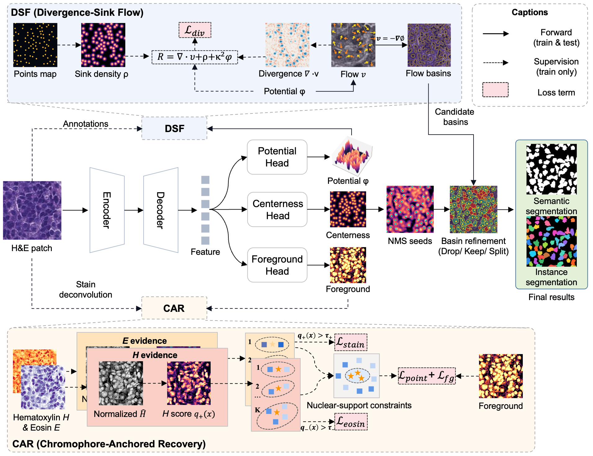

The shared ResNet-34 U-Net predicts foreground, centerness, and scalar potential. DSF turns the potential into sink-directed flow basins, while CAR constrains nuclear support using hematoxylin and eosin evidence. Centerness-guided basin refinement produces the final instance masks.

The canonical path is deliberately small: `dataset.py` prepares the training tensors, `model.py` defines the three-head network, `losses.py` implements the training objective, `train.py` runs optimization, and `eval.py`/`decode_variants.py` perform tiled inference and instance decoding. See [Code structure](docs/CODE_STRUCTURE.md) and [Method guide](docs/METHOD.md).

## Review release contents

Included:

- canonical model, losses, training, preprocessing, tiled inference, and evaluation code;
- exact split manifests and machine-readable paper result tables;
- paper figures and four cropped reviewer examples with pre-generated predictions;
- limited, real training commands and a documented inference interface.

Not included during anonymous review:

- pretrained ChromaFlow checkpoints;
- complete third-party datasets;
- external baseline repositories, their checkpoints, or private experiment logs.

The example predictions below are pre-generated artifacts that document expected outputs. A checkpoint is required to run new predictions. Model weights will be released upon acceptance; see [Model zoo](docs/MODEL_ZOO.md).

## Installation

```bash
conda create -n chromaflow python=3.10 -y
conda activate chromaflow
pip install -r requirements.txt
pip install -e .
```

The canonical ResNet-34 path requires PyTorch, torchvision, NumPy, SciPy, scikit-image, Pillow, PyYAML, OpenCV, and Cellpose. `timm` is only required by optional encoder experiments.

## Reviewer examples

| Dataset | Input | ChromaFlow instances | Boundary overlay |
|---|---|---|---|
| MoNuSeg | 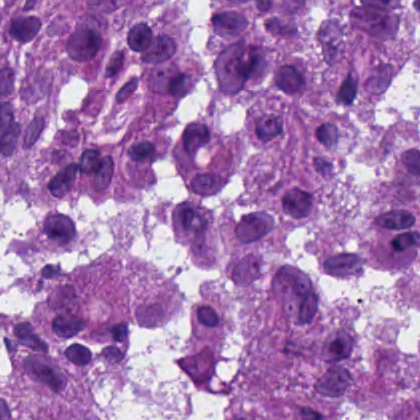 |  | 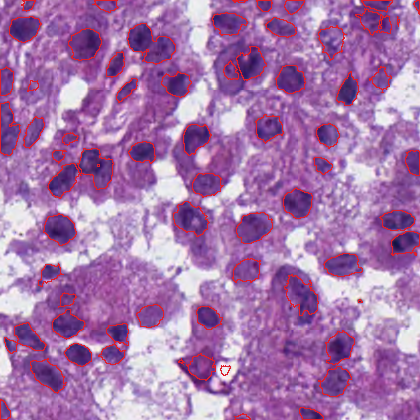 |
| CPM-17 | 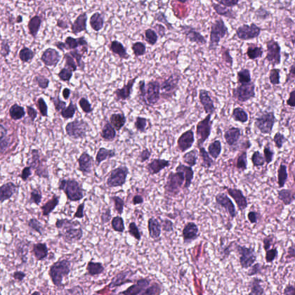 | 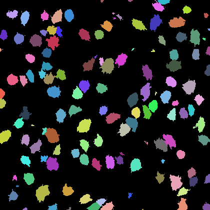 | 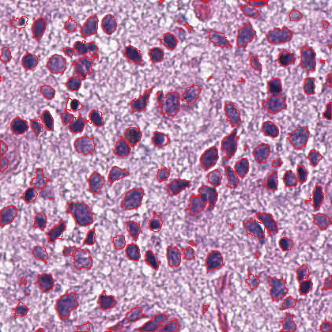 |
| CoNIC | 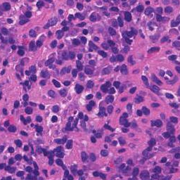 | 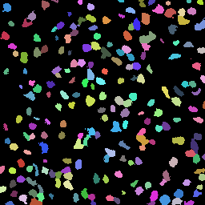 | 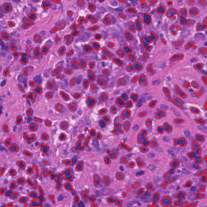 |
| NuInsSeg | 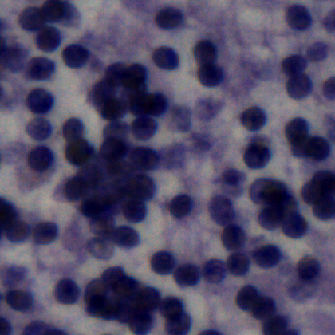 | 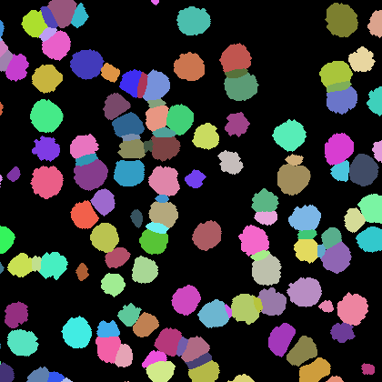 | 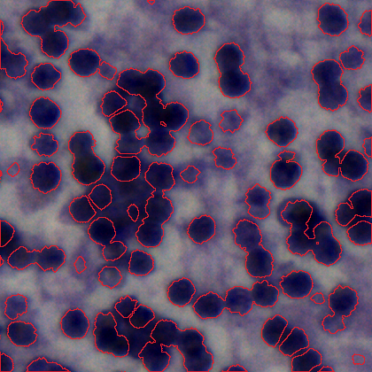 |

Red contours show predicted instance boundaries. The complete provenance, crop coordinates, and source links are in [`assets/demo/manifest.json`](assets/demo/manifest.json). These crops are examples, not a substitute for the source datasets.

## Training and evaluation

Prepare static cluster labels, then train one seed:

```bash
bash scripts/prepare_sav_labels.sh /path/to/project_or_data_root MO
bash scripts/train_canonical_mo.sh /path/to/project_or_data_root 0
```

Evaluate a user-provided checkpoint:

```bash
bash scripts/evaluate.sh \
  /path/to/project_or_data_root MO test \
  /path/to/best_val_aji.pth runs/eval_MO_test
```

The canonical run uses 150 epochs, 224x224 patches, batch size 16, Adam at `1e-4`, validation every 10 epochs, and best-validation-AJI checkpoint selection. See [Training protocol](docs/TRAINING.md), [Inference guide](docs/INFERENCE.md), and [Data format](docs/DATA_FORMAT.md).

## Results and visualizations

ChromaFlow obtains the highest AJI among weakly supervised methods in all four in-domain settings and seven of eight cross-dataset directions. The complete paper tables are available as [structured results](docs/RESULTS.md); visual comparisons, mechanism analyses, robustness, and failure cases are collected in [Visualizations](docs/VISUALIZATIONS.md).

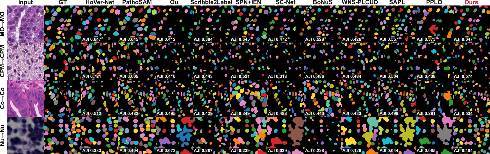

## Documentation

- [Method and workflow](docs/METHOD.md)
- [Code structure](docs/CODE_STRUCTURE.md)
- [Datasets, sources, and splits](docs/DATASETS.md)
- [Training protocol](docs/TRAINING.md)
- [Inference and output format](docs/INFERENCE.md)
- [Paper result tables](docs/RESULTS.md)
- [Visualizations](docs/VISUALIZATIONS.md)
- [Model zoo and release status](docs/MODEL_ZOO.md)

## Reproducibility checks

```bash
python tools/validate_release.py
python tools/sync_results.py /path/to/final/manuscript.tex --check
```

The first command checks split counts/disjointness, result schemas, assets, links, and anonymous-release constraints. The second confirms that the committed CSV tables exactly match the final LaTeX manuscript.

## License and data notice

Repository code is provided for anonymous academic review. Dataset images retain their original licenses and terms; consult the source links in [Datasets](docs/DATASETS.md) before redistribution or downstream use. The four included crops are attributed research examples derived from the datasets used in the paper.
