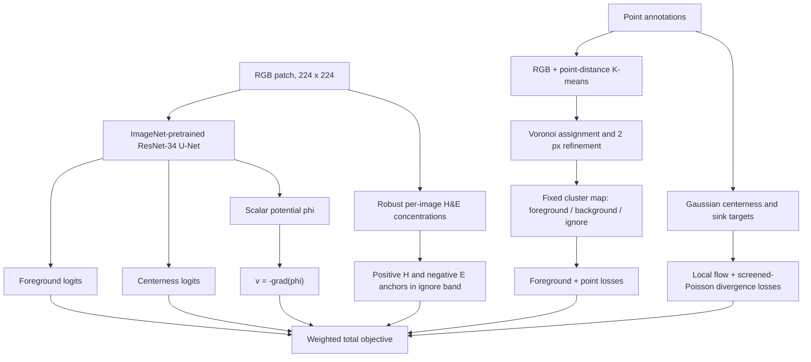

# Method and workflow

## Problem setting

The training annotation is one interior point per nucleus. A point establishes location but does not specify nuclear extent or the boundary between touching nuclei. ChromaFlow treats these as two complementary recovery problems:

1. **instance assignment**, addressed by Divergence-Sink Flow (DSF); and
2. **nuclear support**, addressed by Chromatic Anchor Regularization (CAR).

## Training flow

### Static point-derived supervision

Three-class K-means uses RGB and nearest-point-distance features. Point-based assignment and Voronoi refinement produce a fixed map with foreground (`clu=1`), background (`clu=0`), and an ignore band (`clu=2`). The map is generated once and is not updated during training.

### Divergence-Sink Flow

The potential head predicts a scalar field `phi`; central differences produce `v = -grad(phi)`. A Gaussian around the nearest annotation supplies local sink-directed flow supervision. The divergence term applies a screened-Poisson residual with `kappa=0.1 px^-1`, encouraging coherent attraction basins around points. The local flow term supplies the primary grouping signal; the divergence term regularizes basin structure.

### Chromatic Anchor Regularization

RGB inputs are converted to H&E stain concentrations and robustly normalized with per-image 1st/99th percentiles. In the cluster-map ignore band, hematoxylin-supported pixels act as soft foreground anchors and eosin-supported pixels act as background anchors. Reference thresholds are `tau+=tau-=0.5`; the positive anchor target is `alpha=0.7`.

## Inference flow

Full images are tiled at 224x224 with 64-pixel overlap. Predictions are stitched with cosine blending and averaged over identity, horizontal-flip, and vertical-flip views. Foreground logits supply candidate pixels, predicted flow transports pixels toward sinks, and centerness peaks filter or divide ambiguous basins. Components smaller than 15 pixels are removed.

## Paper-to-code map

| Concept | Canonical implementation |
|---|---|
| ResNet-34 U-Net and potential-to-flow conversion | `chromaflow/model.py` |
| Static point/cluster targets and augmentation | `chromaflow/dataset.py` |
| DSF, CAR, foreground, point, and centerness losses | `chromaflow/losses.py` |
| Optimization and checkpoint selection | `chromaflow/train.py` |
| Tiled inference, metrics, and instance decoding | `chromaflow/eval.py` |
| S4 seed-anchored decoding and TTA variants | `chromaflow/decode_variants.py` |
| Static stain-aware label preparation | `chromaflow/prep_sav_clu.py` |

The repository retains additional research variants for completeness, but they are not part of the canonical ChromaFlow path described above.
