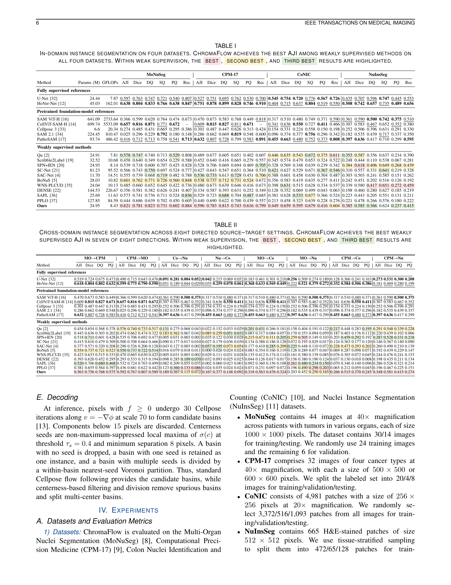

# Paper results

The complete numeric tables are committed in tidy, machine-readable form:

- Table 1, in-domain evaluation: [GitHub-readable table](../results/table1_indomain.md) and [CSV](../results/table1_indomain.csv) — 18 methods x 4 datasets x 6 metrics.
- Table 2, cross-domain evaluation: [GitHub-readable table](../results/table2_crossdomain.md) and [CSV](../results/table2_crossdomain.csv) — 18 methods x 8 directions x 4 metrics.



## ChromaFlow AJI summary

| In-domain | MoNuSeg | CPM-17 | CoNIC | NuInsSeg |
|---|---:|---:|---:|---:|
| ChromaFlow | 0.621 | 0.596 | 0.449 | 0.385 |

| Transfer direction | MO->CPM | CPM->MO | Co->Nu | Nu->Co | MO->Co | MO->Nu | CPM->Co | CPM->Nu |
|---|---:|---:|---:|---:|---:|---:|---:|---:|
| ChromaFlow AJI | 0.563 | 0.592 | 0.189 | 0.167 | 0.318 | 0.203 | 0.266 | 0.348 |

The CSV `group` field preserves the paper's fully supervised, foundation-model, and weakly supervised blocks. Blank values are intentional where a source publication did not report a metric. Rankings and emphasis remain defined by the LaTeX paper; the CSV files store raw values rather than presentation markup.

Foundation models are evaluated directly on each target dataset and are not retrained for every source-to-target pair. Their target-domain values therefore repeat across transfer columns with the same target. SAPL and PPLO results are paper-driven reproductions used for comparison because complete official training implementations were not available to this artifact; their settings follow the cited methods and the common evaluation protocol.

## Consistency check

The CSVs were generated from the final manuscript tables. To detect later drift after editing either artifact, run:

```bash
python tools/sync_results.py /path/to/final/manuscript.tex --check
python tools/render_results_tables.py --check
```

The first command compares every method, dataset/direction, metric, and numeric value, not only the ChromaFlow rows. The second verifies that the GitHub-readable tables still match the committed CSVs.
