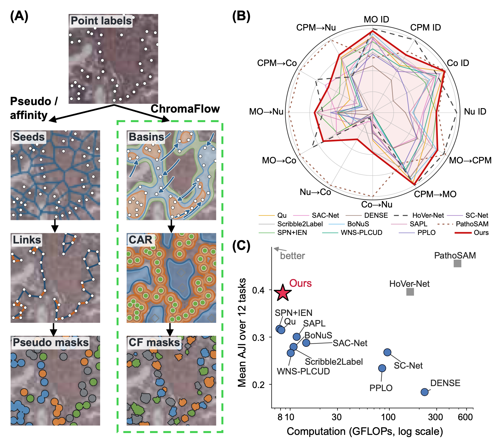
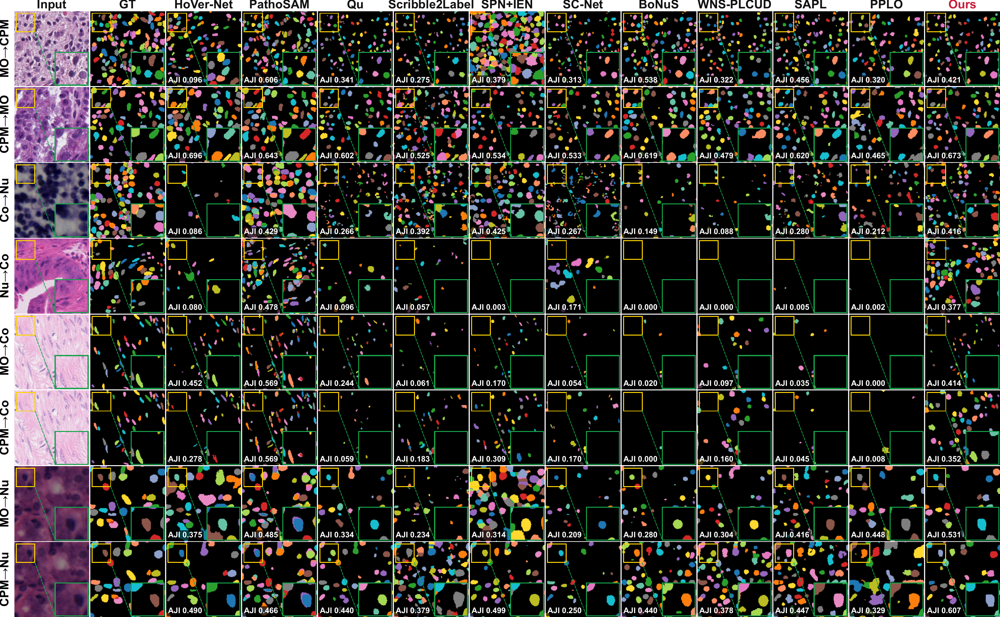
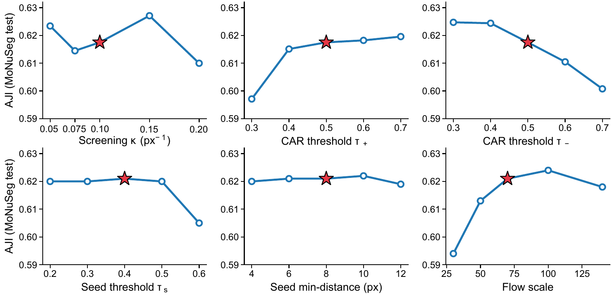
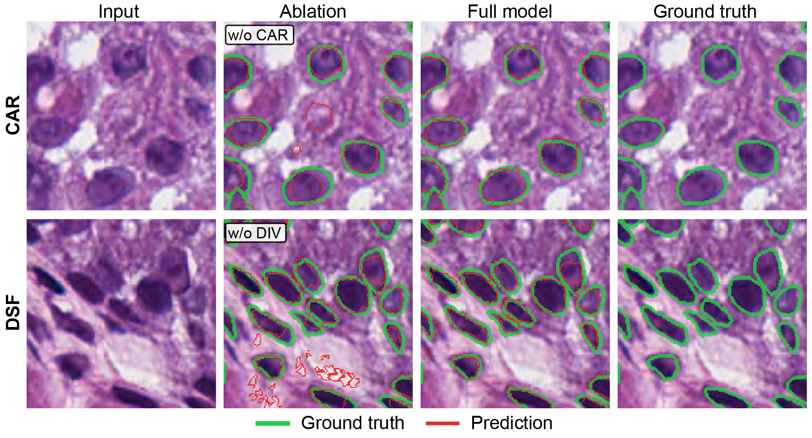
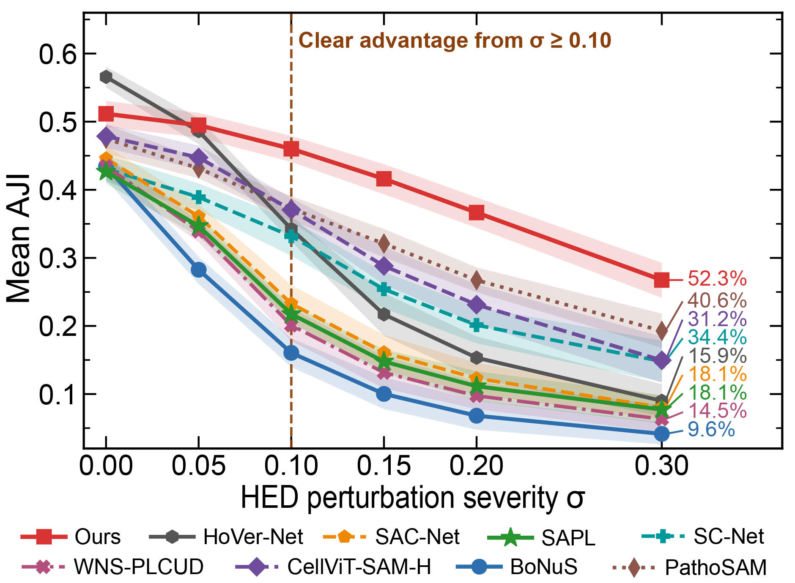
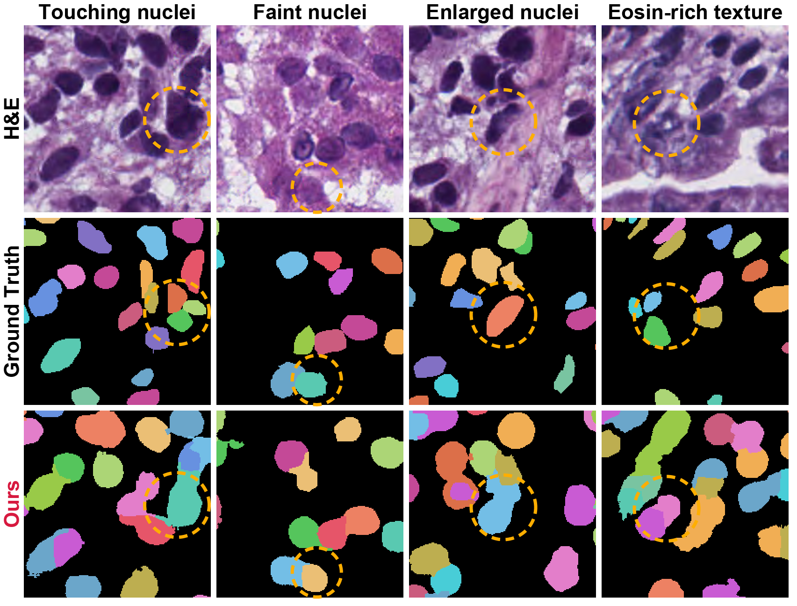
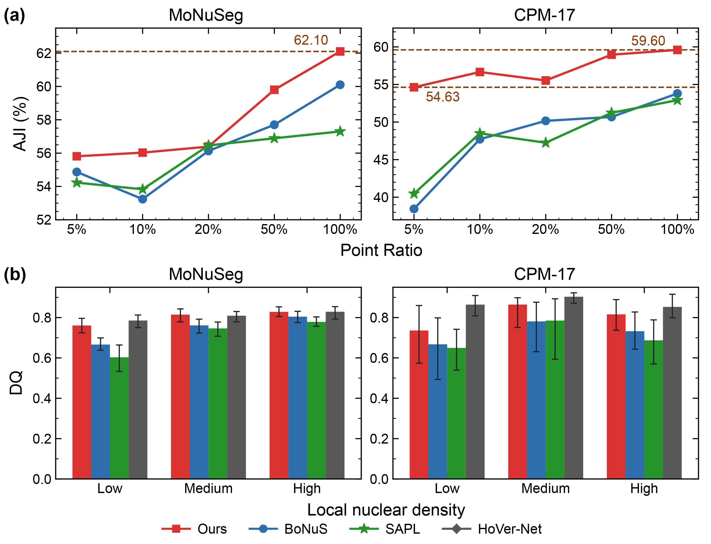

# Visualizations

## Method overview — paper Figures 1 and 2

The overview contrasts point-only supervision with the instance structure recovered by ChromaFlow. Colors denote instance assignments; arrows represent the learned sink-directed flow.

The architecture view links the shared ResNet-34 U-Net features to foreground, centerness, and potential heads. DSF regularizes grouping around point sinks, while CAR anchors nuclear extent using H&E evidence.

## In-domain comparison — paper Figure 3

Rows cover the four evaluation datasets and columns compare representative methods. Colored regions are predicted instances and contours expose merges, splits, and missed nuclei. The [original PDF](../assets/paper/figure3_indomain.pdf) is available for zooming.

## Cross-domain comparison — paper Figure 4

This figure visualizes all eight source-to-target directions. It highlights the effect of stain and morphology shifts when the target domain is not used for training or selection. The [original PDF](../assets/paper/figure4_crossdomain.pdf) is also included.

## Sensitivity — paper Figure 5

Curves report sensitivity to the principal DSF/CAR and decoding settings. The operating point used in the main experiments is fixed from source-domain validation. A vector-quality [PDF](../assets/paper/figure5_sensitivity.pdf) is provided.

## Mechanism ablations — paper Figure 6

These panels isolate the effects of DSF and CAR. DSF primarily improves the separation and assignment of neighboring nuclei; CAR improves the foreground support in chromatically plausible regions.

## Robustness — paper Figure 7

Robustness experiments perturb supervision and image appearance. The comparison shows how analytic structural and stain priors stabilize predictions under imperfect point annotations and domain variation.

## Failure cases — paper Figure 8

The selected failures expose remaining ambiguity in densely overlapping nuclei, weak hematoxylin response, and unusual morphology. They should be read as known limitations rather than cherry-picked successful examples.

## Annotation efficiency — paper Figure 9

This analysis relates performance to point-annotation effort. It motivates the point-supervised setting while retaining fully supervised methods as an upper-context comparison rather than an equal annotation-budget baseline.

The four compact input/prediction/overlay examples used on the repository front page are documented separately in the [demo manifest](../assets/demo/manifest.json).
