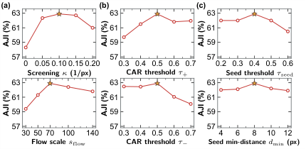
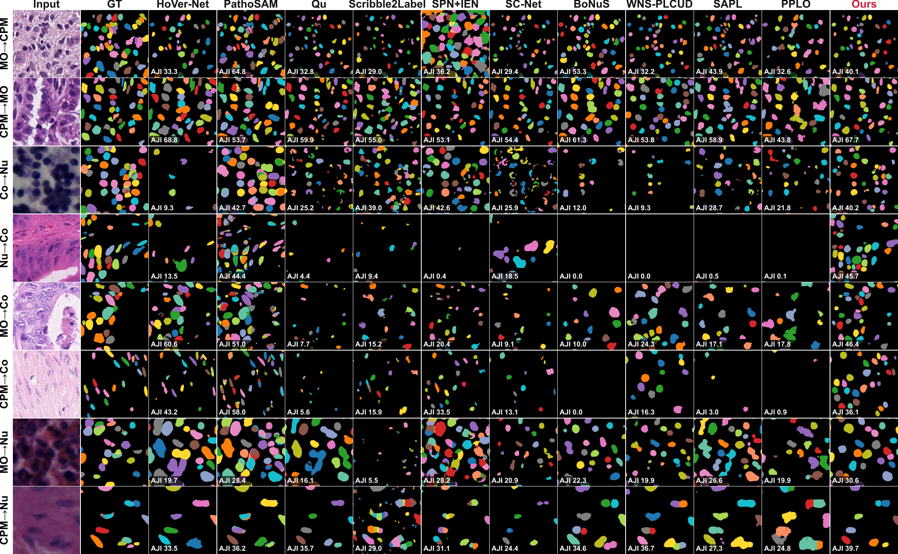
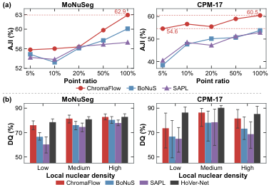
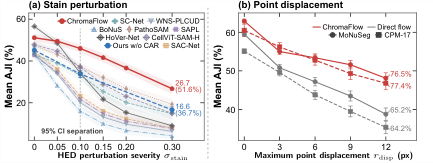
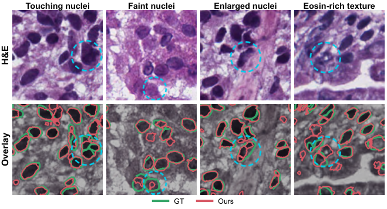

# Current manuscript figures

Figure numbering and assets follow the 2026-10-21 manuscript.

## Figure 1: Overview

## Figure 2: Architecture

## Figure 3: In-domain comparison

## Figure 4: Parameter sensitivity

## Figure 5: Cross-domain comparison

## Figure 6: Mechanism diagnostics

## Figure 7: Point budget and nuclear density

## Figure 8: Stain and point robustness

## Figure 9: Failure cases

